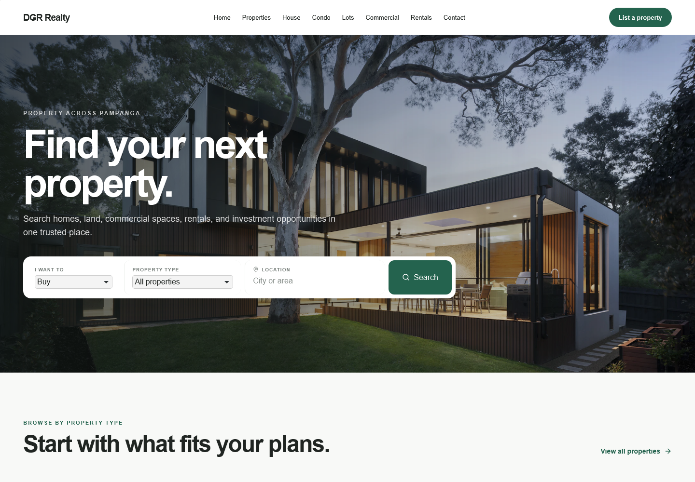
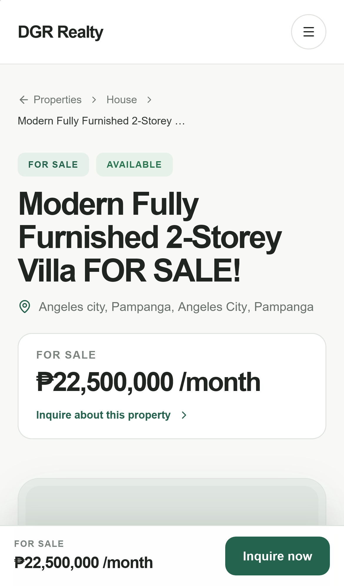

# DGR Realty

A production real-estate website built for an independent Philippine brokerage. Buyers search and filter listings, browse SEO-friendly property pages and send inquiries; the broker manages listings, photos and leads from a secure admin dashboard.

**Live site:** https://dgr2-snowy.vercel.app

  
  

## Features

- **Property search:** URL-based filters, category browsing and full-screen photo galleries, on desktop and mobile
- **SEO:** server-rendered listing pages, sitemap, robots rules and structured metadata
- **Admin dashboard:** create, edit, publish/archive and delete listings with image uploads; saves are transactional, so a failed upload never leaves a half-saved listing
- **Lead inbox:** validated inquiry form with status tracking and optional email notifications
- **Security:** Supabase row-level security, admin multi-factor authentication, Zod input validation, rate limiting, a honeypot and Cloudflare Turnstile spam protection

## Tech stack

Next.js (App Router) · TypeScript · Tailwind CSS · Supabase (PostgreSQL, Auth, Storage) · Zod · Playwright · GitHub Actions · Vercel

## Testing and CI

- 24 Playwright end-to-end tests across public pages, SEO, admin authentication and security
- GitHub Actions runs lint, build and the full browser test suite on every push and pull request
- Smoke tests run automatically against each new Vercel deployment

### Running the checks

Run the local code-quality suite with `npm run check`. For browser tests on
Windows, keep `npm run dev` open in one terminal and run `npm run test:e2e` in a
second terminal. Use `npm run test:e2e:headed` to watch the browser and
`npm run test:e2e:report` to open the latest HTML report. GitHub Actions starts
its own server and runs the complete suite automatically.

Set `PLAYWRIGHT_TEST_BASE_URL` to test an existing deployment. The optional
`E2E_DRAFT_PROPERTY_SLUG` variable enables a check against a real draft record.
Never run future create/edit/delete tests against the production Supabase
project; use a separate test project for destructive admin scenarios.

## Local setup

1. Copy `.env.example` to `.env.local`.
2. Add the public URL and anon key from Supabase Project Settings → API.
3. Run `supabase/migrations/202608310001_initial_real_estate_schema.sql` in a new Supabase project.
4. Run `supabase/migrations/202609010002_inquiries.sql` to create the secure lead inbox.
5. Run `supabase/migrations/202609010003_recoverable_property_mutations.sql` to install transactional admin saves and recoverable image cleanup.
6. Run `supabase/migrations/202609010004_property_publication_visibility.sql` to add draft/published/archived visibility and restrict public property reads.
7. Create the first administrator in Supabase Auth, then run the one-line role update shown at the bottom of the initial migration.
8. Add a server-only Supabase secret key as `SUPABASE_SECRET_KEY`. Never prefix this value with `NEXT_PUBLIC_`.
9. Configure the matching Turnstile site and secret keys for production spam protection. Resend variables are optional and enable email notifications; inquiries are still stored in Supabase without them.
10. Add the public phone, email, Facebook, and Messenger values you want displayed.
11. Run `npm run dev`.

During local development, missing Supabase variables use the polished sample dataset and the admin page shows setup guidance. Production fails visibly instead of presenting sample listings as live inventory.

## Deployment

The repository is configured for Vercel. Copy the relevant values from `.env.example` into the Vercel project environment before deploying. Keep `SUPABASE_SECRET_KEY`, `TURNSTILE_SECRET_KEY`, `INQUIRY_RATE_LIMIT_SALT`, and `RESEND_API_KEY` server-only.

Property images use the public `property-images` Supabase Storage bucket. Database row-level security keeps public browsing read-only and restricts all writes to users whose profile role is `admin`.

Public inquiry forms post to a validated server route. Leads appear under **Admin → Inquiries**, with search, status tracking, optional Resend notifications, privacy consent, a honeypot, rate limiting, and Turnstile verification in production.
