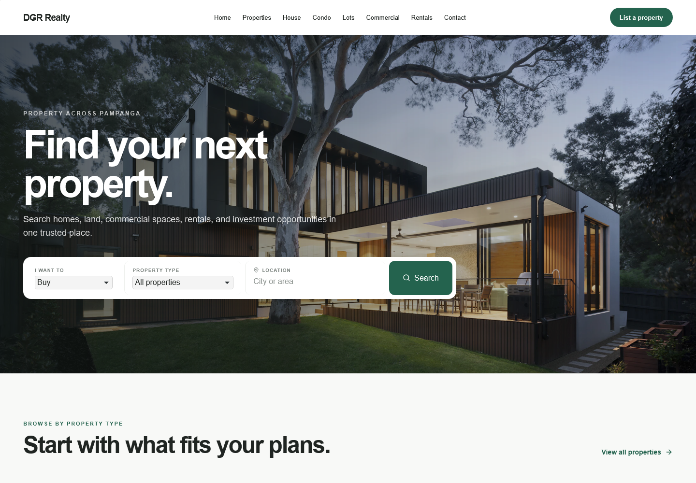
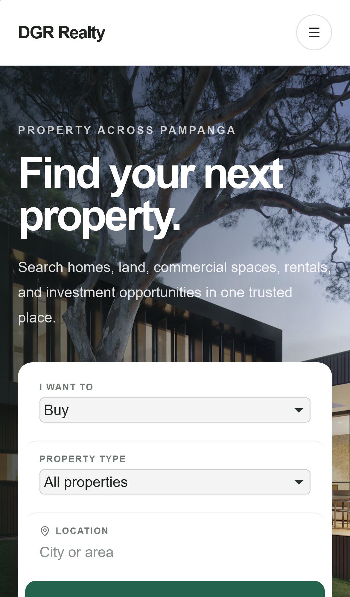
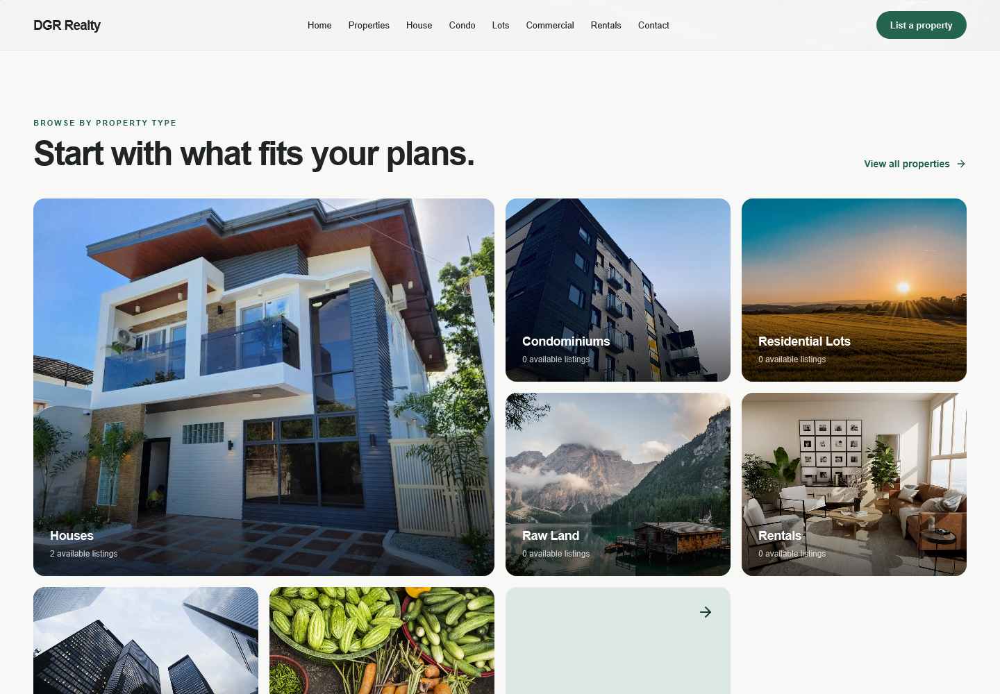
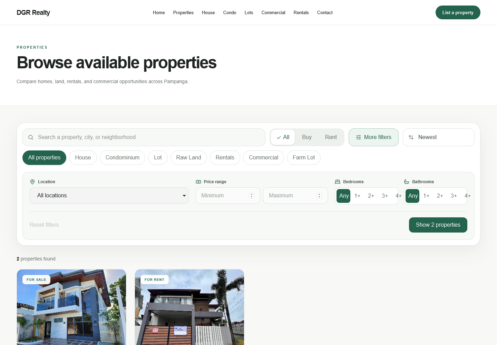
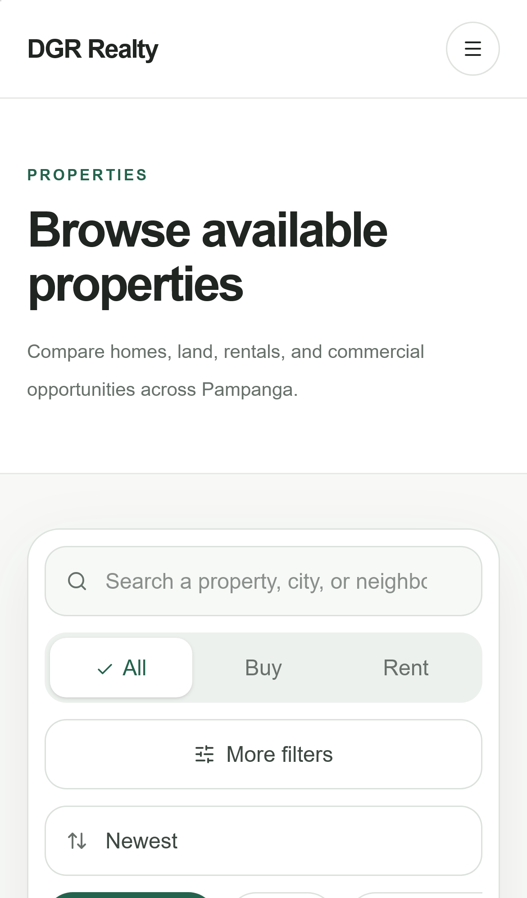
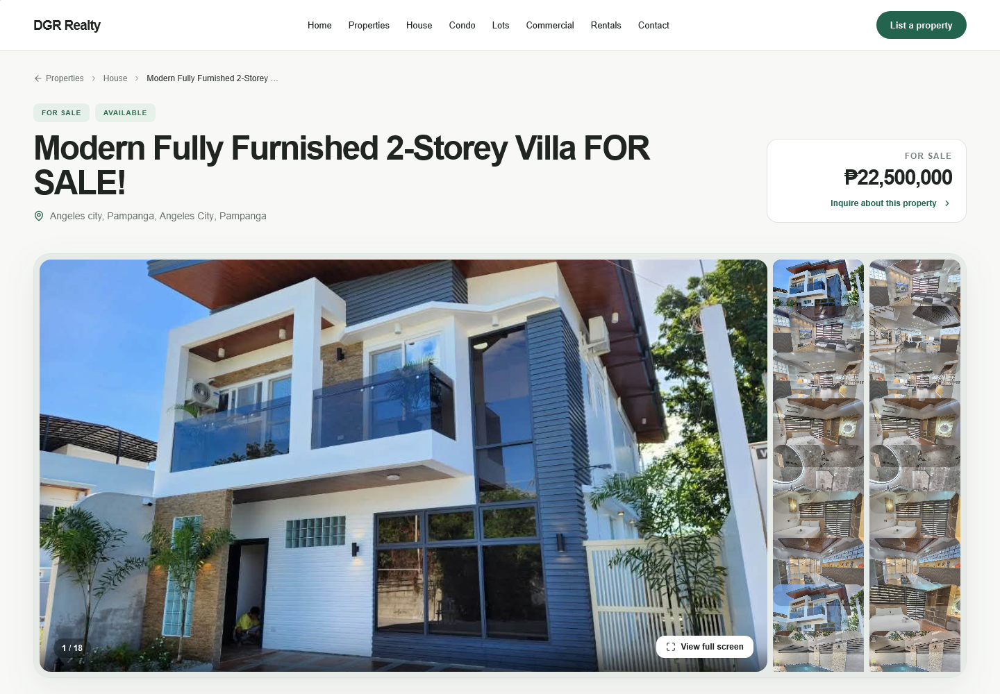
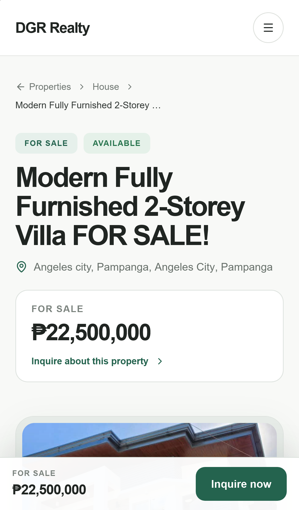
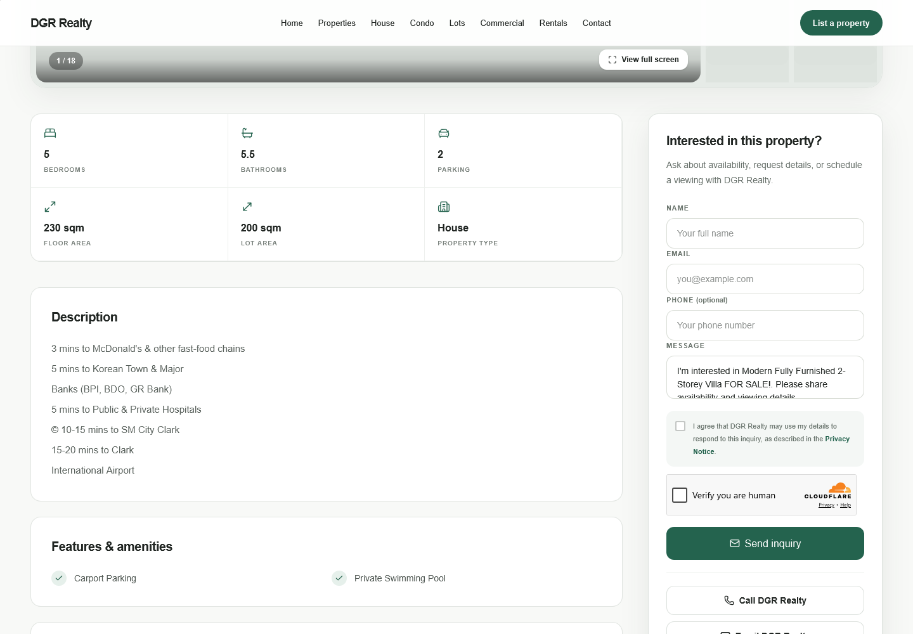

# DGR Realty public buyer-journey audit

Audit date: 2026-09-04  
Surface: live production site at https://dgr2-snowy.vercel.app/  
Flow: homepage entry → category browsing → property search/filtering → property evaluation → inquiry  
Viewports: 1440×1000 desktop and iPhone 13 mobile emulation

## Verdict

DGR Realty is already clean, coherent, and trustworthy enough to feel like a modern independent brokerage. It does not yet feel fully premium. The layout system is considered, but the property content, photography, and mobile first-screen pacing are less disciplined than the green-and-white shell around them.

Taste judgment:

- Product taste: 4/5 — the search → browse → detail → inquiry path is focused and learnable.
- Design taste: 3/5 — strong hierarchy and restraint, but generic typography, repeated rounded-card treatment, stock category imagery, and uncurated listing content keep it from feeling distinctive.

Highest-leverage change: establish a listing quality standard before adding more decoration. Normalize titles and locations, reject duplicate metadata, rotate/crop every photo correctly, and choose a deliberate main image. Premium property sites are judged first by the inventory presentation.

## What already works

- The homepage has one clear promise and one obvious task: find a property.
- The forest-green palette is restrained, readable, and consistent.
- Search filters use progressive disclosure well; common choices stay visible while detailed filters stay out of the way.
- Property details expose useful specs, an image count, a full-screen gallery, and a direct inquiry path.
- Mobile avoids horizontal overflow and keeps an inquiry action available with the sticky bottom bar.
- Empty search results and missing-photo states have written recovery guidance rather than blank space.
- Reduced-motion support is present in the current stylesheet.

## Flow steps

### 1. Homepage entry — healthy, with mobile pacing risk

The desktop hero feels confident: strong image, clear headline, and a compact search surface. On mobile, the headline, paragraph, and stacked form consume more than the first screen, so the search button is not immediately visible. The mobile first screen should be compressed enough to show the beginning of the form and its primary action sooner.

### 2. Category browsing — visually strong, weak when inventory is empty

The mosaic creates useful visual rhythm, but most tiles show “0 available listings” and fall back to generic stock imagery. The alpine-lake image for “Raw Land” is especially disconnected from Pampanga. Hide empty categories, move them below active inventory, or use locally credible editorial images.

### 3. Search and filters — healthy

The segmented sale/rent control, category chips, and “More filters” disclosure are easy to understand. The open panel keeps the advanced controls grouped logically. The disabled “Reset filters” label is extremely faint, and small category/room controls should be checked against a 44×44px mobile target.

On mobile, the oversized page introduction delays the actual inventory. Reduce the heading block and vertical whitespace so search results appear sooner.

### 4. Property evaluation — functionally strong, content quality is the premium blocker

The gallery, price summary, badges, and inquiry shortcut make the page scannable. Several thumbnails are visibly rotated or repetitive, and the title repeats “FOR SALE!” even though two badges already communicate that state. The location repeats “Angeles City, Pampanga.” These are small data issues with a large trust cost.

On mobile, the title becomes the dominant visual object and pushes most of the hero photo below the fold. Shorter editorial titles and a smaller mobile type scale would let the property itself lead.

### 5. Inquiry path — healthy, with accessibility follow-up

The inquiry card is visible beside the key details, includes privacy consent, and gives alternate contact routes. The long description reads like pasted notes rather than finished listing copy; convert this to a short overview plus structured nearby-landmark bullets. The form was not submitted during this audit to avoid creating a production lead.

## Priority recommendations

1. **Create a listing quality gate.** Clean title casing and punctuation, deduplicate location parts, validate price suffixes against sale/rent, rotate/crop photos, remove near-duplicates, and require a strong cover image.
2. **Compress mobile first screens.** Reduce mobile heading size and top/bottom spacing on the homepage, listings page, and detail page so search, inventory, and photography appear sooner.
3. **Use authentic inventory imagery.** Do not let generic stock photos and zero-count categories dominate the homepage. Prefer local images, active categories, or a restrained text-only empty state.
4. **Give the brand a more distinctive type voice.** Keep the sans-serif body, but consider one carefully chosen display face or a better grotesk for headlines. Arial makes the otherwise polished layout feel generic.
5. **Reduce decorative repetition.** Keep rounded cards where they communicate grouping, but flatten some full-width sections and reduce shadows so the inquiry card and primary actions carry the elevation hierarchy.
6. **Tighten navigation.** The desktop header lists multiple property categories alongside “Properties.” A single Properties entry with category discovery on the page would feel calmer and more premium.
7. **Finish keyboard behavior.** The gallery dialog supports Escape and arrow keys but does not visibly manage or trap focus. Add focus placement, focus containment, and focus restoration; also verify focus indicators across hero controls.
8. **Raise small muted text contrast.** `#747c77` on white measures about 4.29:1, below the 4.5:1 target for normal text, and it is used at very small sizes in parts of the interface.

## Evidence limits

- This was a screenshot-led public buyer-journey audit, not a full WCAG conformance review.
- Admin screens were out of scope and were not opened.
- The inquiry form was inspected but not submitted, to avoid creating a real production lead.
- Screen-reader announcements, full keyboard order, browser zoom/reflow above 100%, and real-device performance still need dedicated testing.
